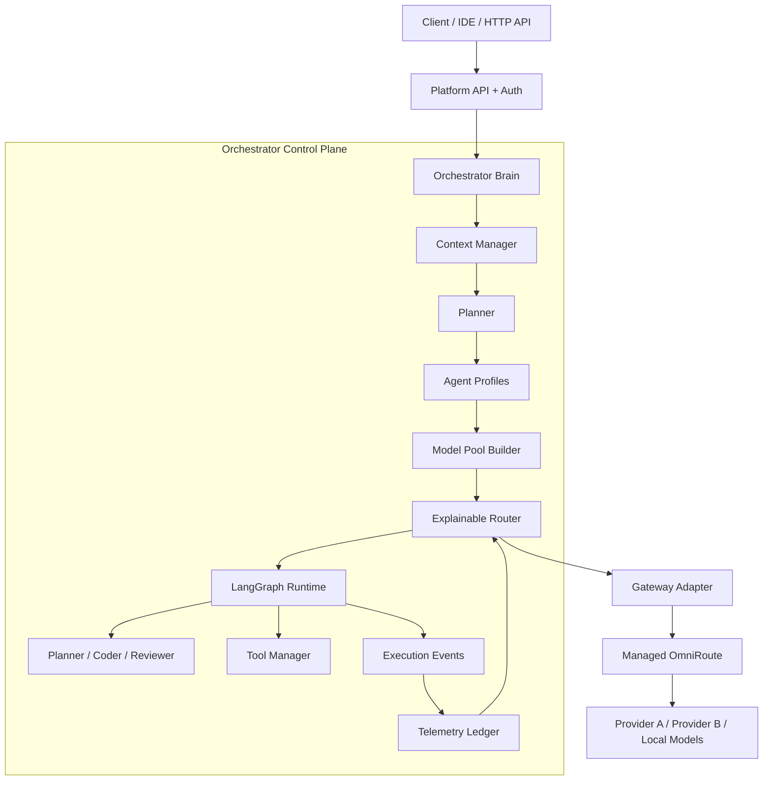

# TotalOrch — MVP Plan

**Status:** In progress — phases 0–5 implementation slice complete; live OmniRoute acceptance pending

**Version:** 1.0

**Last updated:** 2026-09-08

## Implementation status

The phase 0–5 foundation is implemented under `src/total_orch/` with
contract tests, a configurable OmniRoute adapter, a local Model Intelligence
Registry (persistence, catalog ingestion, canonical identity, field-authority
merging, staleness, and query APIs), default Agent Profiles with an
automatic, explainable Model Pool builder (`src/total_orch/profiles/`), and
the explainable router (`src/total_orch/router/`): hard-constraint filtering
before weighted scoring, five policy presets plus preference-derived
policies, per-factor scoring with human-readable contributions, deterministic
tie-breaking, bounded exploration, ordered fallbacks, a route-preview API,
and SQLite `RouteDecision` persistence with policy-weight snapshots. The
deterministic test suite passes, but live phase-2 acceptance still requires a
running managed OmniRoute instance with at least two configured Providers.
This distinction is intentional: code-level adapter, registry, pool-builder,
and router coverage is complete, while environment-level Provider verification
must use real credentials and must not be faked.

## 1. MVP Objective

The MVP must prove the platform's central architectural boundary:

```text
OmniRoute
    ↓
Gateway Adapter
    ↓
Model Intelligence Registry
    ↓
Default Agent Profiles and Model Pools
    ↓
Explainable Router
    ↓
LangGraph Workflow Runtime
    ↓
Planner → Developer/Coder → Reviewer
```

The MVP is successful when a user can connect at least two Providers through the platform, see the discovered models, receive automatically generated Agent Pools, submit one software-development task, and obtain a routed and validated result through a real LangGraph workflow.

The user must not be required to install or configure OmniRoute separately. OmniRoute is provisioned and managed as the default internal execution gateway.

## 2. Architectural Decisions

| Area | MVP decision |
| :--- | :--- |
| Execution gateway | OmniRoute as a managed internal service or sidecar |
| Provider adapters | Reuse OmniRoute; do not duplicate Provider integrations |
| Gateway integration | A small internal `GatewayAdapter` using stable APIs |
| Orchestration Brain | Custom application logic owned by this project |
| Workflow runtime | LangGraph |
| Model intelligence | Custom normalized local registry |
| Model grouping | Model Family → Model Variant → Provider Endpoint |
| Default routing | Automatically generated Agent Profiles and Model Pools |
| Routing | Hard capability constraints followed by weighted scoring |
| Routing transparency | Every decision returns selected, excluded, score factors, and fallback path |
| Short-term execution state | LangGraph checkpoints |
| Performance and routing telemetry | Custom execution and routing ledger |
| User configuration | Defaults first; advanced customization is optional |

The detailed architectural background is documented in:

- [Vision](docs/Vision.md)
- [Architecture](docs/Architecture.md)
- [Requirements](docs/Requirements.md)
- [Gateway Comparison](docs/Researchs/Gateway_Comparison.md)
- [Model Catalog Research](docs/Researchs/Model_Catalog_Research.md)
- [AI-Agents-Orchestrator Analysis](docs/Researchs/AI_Agents_Orchestrator_Analysis.md)

## 3. MVP Scope

### In scope

- Managed OmniRoute deployment for local development
- Provider onboarding through the platform boundary
- Provider and model discovery from OmniRoute
- Model normalization and Family/Variant/Endpoint grouping
- Capability resolution for tool calling, reasoning, structured output, and context size
- Metadata enrichment from models.dev and OpenRouter
- Provider Endpoint health and latency observations
- Default Planner, Developer/Coder, and Reviewer profiles
- Automatic Model Pool generation
- Explainable model routing
- LangGraph workflow execution
- Basic tool invocation for repository inspection and test execution
- Structured telemetry, logs, and routing decisions
- Retry, fallback, timeout, and cancellation behavior
- Unit, contract, integration, and end-to-end tests
- A minimal API and developer-facing CLI or HTTP client

### Out of scope for the core MVP

- Full production multi-tenant billing
- Marketplace for Agents, Skills, or Plugins
- Unbounded Agentic Team conversations
- Complete Graphify-style code knowledge graph
- Reinforcement learning or autonomous policy mutation
- Dozens of workflow templates
- Full visual workflow designer
- Supporting every OmniRoute management feature in our UI
- Duplicating OmniRoute Provider adapters
- Replacing OmniRoute's dashboard

These features may be implemented after the MVP as extensions or stretch milestones.

## 4. Target User Journey

```text
1. Start the platform
2. OmniRoute starts as an internal managed service
3. Add Provider A and Provider B in our UI/API
4. The platform validates the connections through OmniRoute
5. Models are discovered and normalized
6. Default Agent Profiles and Pools are generated
7. User submits a coding task
8. Planner creates a plan
9. Developer/Coder implements the change
10. Reviewer evaluates the result
11. Tests run when available
12. The platform returns the result and routing explanation
```

## 5. MVP Architecture



## 6. Work Breakdown Structure

### Phase 0 — Project Foundation and Decision Freeze

**Goal:** Make the MVP reproducible and prevent architecture drift.

#### Tasks

- [x] **MVP-0001** Confirm the MVP boundary and Definition of Done.
- [x] **MVP-0002** Create an Architecture Decision Record for OmniRoute as the managed internal gateway.
- [x] **MVP-0003** Create an Architecture Decision Record for LangGraph as the workflow runtime.
- [x] **MVP-0004** Define supported deployment modes: local development, Docker Compose, and optional external OmniRoute.
- [x] **MVP-0005** Define the supported initial Provider test matrix.
- [x] **MVP-0006** Define the initial task type: software feature or bug-fix workflow.
- [x] **MVP-0007** Establish coding, formatting, typing, testing, and security checks.
- [x] **MVP-0008** Define the configuration and secret-management policy.

#### Deliverables

- MVP scope accepted by the team
- Reproducible local development setup
- Initial ADRs
- Provider test matrix
- Definition of Done

#### Acceptance criteria

- A new developer can start the platform from documented instructions.
- The MVP does not require manual OmniRoute installation outside the platform setup.
- Every later phase has a clear dependency and test boundary.

### Phase 1 — Core Domain Contracts

**Goal:** Establish stable contracts before implementing integrations.

#### Tasks

- [x] **MVP-0101** Define `ProviderConnectionRef`.
- [x] **MVP-0102** Define `ModelFamily`.
- [x] **MVP-0103** Define `ModelVariant`.
- [x] **MVP-0104** Define `ProviderEndpoint`.
- [x] **MVP-0105** Define `ModelCapabilities`.
- [x] **MVP-0106** Define `AgentDefinition`.
- [x] **MVP-0107** Define `AgentProfile`.
- [x] **MVP-0108** Define `ModelPool`.
- [x] **MVP-0109** Define `RouteRequest` and `RouteDecision`.
- [x] **MVP-0110** Define `WorkflowDefinition`, `WorkflowTask`, and `WorkflowResult`.
- [x] **MVP-0111** Define `ExecutionEvent` and `RoutingEvent`.
- [x] **MVP-0112** Define versioning, timestamps, provenance, and confidence fields.
- [x] **MVP-0113** Add schema validation and contract tests.

#### Required identity model

```text
Model Family
  └── Model Variant
        └── Provider Endpoint
              └── Provider Connection / Account
```

Provider identity must not be confused with model publisher identity. For example, an OpenRouter source ID may identify a model published by one organization while the actual serving endpoint belongs to OpenRouter or another configured Provider.

#### Acceptance criteria

- The contracts represent the same logical model served by multiple Providers.
- Endpoint-specific health, latency, cost, quota, and capabilities can be stored.
- Unknown metadata is represented as unknown rather than guessed.
- Contract tests reject invalid capability and routing records.

### Phase 2 — Managed OmniRoute and Gateway Adapter

**Goal:** Connect the Orchestrator to a real OmniRoute instance without duplicating Provider logic.

#### Tasks

- [x] **MVP-0201** Add OmniRoute to the local managed deployment.
- [x] **MVP-0202** Add environment-based configuration for the internal OmniRoute URL and service credentials.
- [x] **MVP-0203** Implement `GatewayAdapter` interface.
- [x] **MVP-0204** Implement Provider connection discovery.
- [x] **MVP-0205** Implement Provider model discovery.
- [x] **MVP-0206** Implement all-model discovery through `/v1/models` or the supported management catalog endpoint.
- [x] **MVP-0207** Implement Provider connection validation and health checks.
- [x] **MVP-0208** Implement provider-prefixed model execution.
- [x] **MVP-0209** Normalize streaming responses into the platform response contract.
- [x] **MVP-0210** Normalize gateway response metadata into execution events.
- [x] **MVP-0211** Add a fake Gateway Adapter for unit and deterministic integration tests.
- [x] **MVP-0212** Add adapter timeout, retry classification, and error normalization.
- [x] **MVP-0213** Ensure raw Provider secrets never enter the Model Registry.

#### Gateway responsibilities

OmniRoute owns:

- Provider adapters
- Credential and OAuth handling
- Provider-specific translation
- Streaming transport
- Connection selection
- Operational retry and fallback
- Circuit breakers and cooldowns

The Orchestrator owns semantic model selection and must not independently route across the entire Provider catalog after making a decision.

#### Acceptance criteria

- The adapter can discover at least two configured Providers.
- The adapter can discover models from both Providers.
- The adapter can send a request to a specific `provider/model` target.
- A simulated Provider failure produces a normalized error and a controlled fallback.
- The fake adapter can run all Router tests without a live external service.

### Phase 3 — Model Intelligence Registry

**Goal:** Build a local, cached, normalized registry that combines gateway discovery with external metadata.

#### Tasks

- [x] **MVP-0301** Implement registry persistence using the selected local database.
- [x] **MVP-0302** Implement OmniRoute catalog ingestion.
- [x] **MVP-0303** Implement models.dev ingestion.
- [x] **MVP-0304** Implement OpenRouter model metadata ingestion.
- [x] **MVP-0305** Implement canonical family and variant mapping.
- [x] **MVP-0306** Implement Provider and endpoint alias mapping.
- [x] **MVP-0307** Implement capability normalization.
- [x] **MVP-0308** Implement optional reasoning-effort metadata.
- [x] **MVP-0309** Implement context-window and maximum-output normalization.
- [x] **MVP-0310** Implement price and cost normalization.
- [x] **MVP-0311** Store per-field provenance and freshness.
- [x] **MVP-0312** Implement conflict resolution by field authority.
- [x] **MVP-0313** Implement incremental synchronization and idempotent upserts.
- [x] **MVP-0314** Implement stale-record detection.
- [x] **MVP-0315** Add registry query APIs.
- [x] **MVP-0316** Add registry consistency tests.

#### Initial capability set

- `tool_calling`
- `reasoning`
- `reasoning_effort`
- `structured_output`
- `vision`
- `multimodal`
- `context_window`
- `max_output_tokens`
- `streaming`

#### Acceptance criteria

- The same logical model can be grouped across at least two Providers.
- Provider Endpoint health and latency remain separate from base model metadata.
- An endpoint with unknown Tool Calling support is not silently treated as supported.
- Registry refresh is idempotent.
- Routing does not block on live external catalog requests.

### Phase 4 — Default Agent Profiles and Automatic Pools

**Goal:** Make the platform useful without requiring users to build configuration from scratch.

#### Tasks

- [x] **MVP-0401** Define the built-in Planner profile.
- [x] **MVP-0402** Define the built-in Developer/Coder profile.
- [x] **MVP-0403** Define the built-in Reviewer profile.
- [x] **MVP-0404** Define optional Researcher and Tester profiles.
- [x] **MVP-0405** Define hard capability requirements for each profile.
- [x] **MVP-0406** Implement automatic Pool Builder rules.
- [x] **MVP-0407** Implement the `tool_calling` Pool.
- [x] **MVP-0408** Implement the `reasoning` Pool.
- [x] **MVP-0409** Implement the `large_context` Pool.
- [x] **MVP-0410** Implement family-based Pools.
- [x] **MVP-0411** Implement role-specific default Pools.
- [x] **MVP-0412** Add user include/exclude overrides.
- [x] **MVP-0413** Add pinning of a specific model or Provider Endpoint.
- [x] **MVP-0414** Add reset-to-default behavior.
- [x] **MVP-0415** Add Pool membership explanations.

#### Initial default profiles

| Agent | Hard requirements | Default preference |
| :--- | :--- | :--- |
| Planner | reasoning or strong planning fitness, structured output, adequate context | quality and reliability |
| Developer/Coder | tool calling, coding fitness, streaming, adequate context | balanced quality and latency |
| Reviewer | reasoning, code analysis fitness, structured output | quality and stability |
| Researcher | tool calling, search support where available, long context | reliability and availability |
| Tester | tool access, structured output, deterministic response behavior | reliability and low latency |

#### Acceptance criteria

- A fresh installation produces usable default profiles.
- The user can see why a model belongs to an Agent Pool.
- The user can customize a profile without editing raw configuration files.
- Hard capability requirements are never bypassed by a high quality score.

### Phase 5 — Explainable Router

**Goal:** Select a concrete endpoint for an Agent task and make the decision understandable.

#### Tasks

- [x] **MVP-0501** Define hard-constraint filtering.
- [x] **MVP-0502** Define role-fit scoring.
- [x] **MVP-0503** Define capability-fit scoring.
- [x] **MVP-0504** Define quality and task-fit scoring.
- [x] **MVP-0505** Define health and error-rate scoring.
- [x] **MVP-0506** Define latency scoring.
- [x] **MVP-0507** Define cost and quota scoring.
- [x] **MVP-0508** Define historical task-outcome scoring.
- [x] **MVP-0509** Implement policy presets: quality-first, balanced, cost-first, latency-first, reliable-first.
- [x] **MVP-0510** Implement deterministic tie-breaking.
- [x] **MVP-0511** Implement optional bounded exploration.
- [x] **MVP-0512** Implement fallback target selection.
- [x] **MVP-0513** Implement `RouteDecision` persistence.
- [x] **MVP-0514** Implement a route-preview API for debugging and UI use.
- [x] **MVP-0515** Add explainability tests.

#### Initial scoring model

```text
Final Score =
  Role Fit            × w_role
+ Capability Fit     × w_capability
+ Quality / Task Fit × w_quality
+ Health             × w_health
+ Latency            × w_latency
+ Cost               × w_cost
+ Quota              × w_quota
+ Historical Success × w_history
```

Hard constraints run before scoring. Scores must be versioned so a historical routing decision can be reconstructed after policy changes.

#### Acceptance criteria

- The Router never selects an endpoint that fails a hard capability constraint.
- The Router returns the selected endpoint and an ordered fallback list.
- The Router returns per-factor contributions.
- The Router returns excluded candidates with reasons.
- The same input and policy produce a deterministic result when exploration is disabled.
- A route decision can be replayed from stored registry and policy snapshots.

### Phase 6 — LangGraph Workflow Runtime

**Goal:** Execute the first real multi-agent workflow with state, checkpoints, and validation.

#### Tasks

- [ ] **MVP-0601** Define the workflow state schema.
- [ ] **MVP-0602** Implement request intake and task classification.
- [ ] **MVP-0603** Implement Planner node.
- [ ] **MVP-0604** Implement Developer/Coder node.
- [ ] **MVP-0605** Implement Reviewer node.
- [ ] **MVP-0606** Implement optional Tester node.
- [ ] **MVP-0607** Resolve an Agent's Model Pool before execution.
- [ ] **MVP-0608** Execute model calls through the Gateway Adapter.
- [ ] **MVP-0609** Add checkpointing after every workflow node.
- [ ] **MVP-0610** Add retry and fallback at node level.
- [ ] **MVP-0611** Add result validation and structured output parsing.
- [ ] **MVP-0612** Add cancellation and timeout propagation.
- [ ] **MVP-0613** Add final result aggregation.
- [ ] **MVP-0614** Add workflow replay for failed runs.

#### First workflow

```text
Receive Task
    ↓
Classify Intent
    ↓
Planner
    ↓
Developer/Coder
    ↓
Reviewer
    ↓
Optional Test Runner
    ↓
Aggregate and Return
```

#### Acceptance criteria

- A workflow can pause and resume from a checkpoint.
- A failed model call can retry or use a permitted fallback endpoint.
- Reviewer output can reject the implementation and trigger a bounded correction loop.
- Every node emits structured execution events.
- The final response includes the relevant artifacts and validation result.

### Phase 7 — Minimal Tools and Repository Context

**Goal:** Make the coding workflow useful on a real repository without building the complete Graphify system.

#### Tasks

- [ ] **MVP-0701** Define Tool Manager contracts.
- [ ] **MVP-0702** Implement safe filesystem inspection.
- [ ] **MVP-0703** Implement repository status and diff inspection.
- [ ] **MVP-0704** Implement controlled patch application.
- [ ] **MVP-0705** Implement test command execution in a sandbox.
- [ ] **MVP-0706** Add timeout, output limits, and cancellation to tools.
- [ ] **MVP-0707** Add tool permission checks per Agent Profile.
- [ ] **MVP-0708** Add basic project metadata and file index.
- [ ] **MVP-0709** Add context provenance to Planner and Reviewer inputs.
- [ ] **MVP-0710** Add an MCP integration spike for one read-only tool.

#### Acceptance criteria

- The Coder can inspect relevant files through approved tools.
- The Coder cannot execute arbitrary commands outside the configured sandbox.
- The Reviewer receives the actual diff and test output.
- Tool activity is included in the execution trace.

### Phase 8 — Telemetry, Health, and Feedback

**Goal:** Capture the data needed for reliable routing and future adaptation.

#### Tasks

- [ ] **MVP-0801** Implement request and workflow trace IDs.
- [ ] **MVP-0802** Record Provider Endpoint latency and time-to-first-token where available.
- [ ] **MVP-0803** Record token usage and estimated cost.
- [ ] **MVP-0804** Record status, error class, retry count, and fallback use.
- [ ] **MVP-0805** Record Agent, model, Provider, and Pool assignments.
- [ ] **MVP-0806** Record validation results, test results, and user acceptance signals where available.
- [ ] **MVP-0807** Implement rolling health aggregates.
- [ ] **MVP-0808** Update endpoint availability and cooldown signals.
- [ ] **MVP-0809** Add a read-only routing and execution report.
- [ ] **MVP-0810** Keep adaptive policy changes disabled by default until enough data exists.

#### Acceptance criteria

- Every completed or failed request produces a traceable telemetry record.
- Health data is scoped by Provider, Connection, and Model Endpoint.
- Telemetry ingestion does not block the response path.
- A later routing decision can use historical task-specific outcomes.

### Phase 9 — API, Security, and Developer Experience

**Goal:** Make the MVP usable and safe for local development.

#### Tasks

- [ ] **MVP-0901** Implement authenticated task submission.
- [ ] **MVP-0902** Implement Provider onboarding endpoints.
- [ ] **MVP-0903** Implement model catalog endpoints.
- [ ] **MVP-0904** Implement Agent Profile and Pool read APIs.
- [ ] **MVP-0905** Implement route-preview and route-explanation APIs.
- [ ] **MVP-0906** Implement workflow status and event streaming.
- [ ] **MVP-0907** Implement cancellation.
- [ ] **MVP-0908** Redact secrets from logs, traces, and model metadata.
- [ ] **MVP-0909** Add authorization for Provider management, tools, and execution.
- [ ] **MVP-0910** Add rate limits and request-size limits.
- [ ] **MVP-0911** Add prompt-injection and unsafe-tool-input boundaries.
- [ ] **MVP-0912** Document local installation and first-run setup.

#### Minimum API surface

```text
POST /api/tasks
GET  /api/tasks/{task_id}
POST /api/tasks/{task_id}/cancel
GET  /api/tasks/{task_id}/events

GET  /api/providers
POST /api/providers
POST /api/providers/{id}/test

GET  /api/models
GET  /api/models/families
GET  /api/models/pools
GET  /api/agents/profiles

POST /api/routing/preview
GET  /api/routing/decisions/{id}
```

#### Acceptance criteria

- A user can complete the first-run flow without accessing OmniRoute directly.
- Provider credentials are never returned by catalog APIs.
- Task status and events can be followed without polling the internal workflow process directly.
- Unsafe tools and unauthorized Provider management calls are rejected.

### Phase 10 — Verification and Release Readiness

**Goal:** Prove that the MVP is reliable enough for controlled internal use.

#### Tasks

- [ ] **MVP-1001** Add unit tests for all domain contracts.
- [ ] **MVP-1002** Add Model Registry normalization tests.
- [ ] **MVP-1003** Add source-conflict and stale-data tests.
- [ ] **MVP-1004** Add Pool Builder tests.
- [ ] **MVP-1005** Add Router scoring and explainability tests.
- [ ] **MVP-1006** Add Gateway Adapter contract tests using a fake gateway.
- [ ] **MVP-1007** Add OmniRoute integration tests.
- [ ] **MVP-1008** Add LangGraph workflow tests.
- [ ] **MVP-1009** Add retry, fallback, timeout, and cancellation tests.
- [ ] **MVP-1010** Add tool sandbox and permission tests.
- [ ] **MVP-1011** Add end-to-end tests for Planner → Coder → Reviewer.
- [ ] **MVP-1012** Add failure-injection tests for Provider outage and model unavailability.
- [ ] **MVP-1013** Add a smoke test for a clean installation.
- [ ] **MVP-1014** Document known limitations and operational runbooks.

## 7. Dependency Graph

```text
Phase 0
  ↓
Phase 1 ───────────────┐
  ↓                    │
Phase 2                │
  ↓                    │
Phase 3 ───────→ Phase 4
  ↓                    ↓
Phase 5 ───────→ Phase 6
                       ↓
              Phase 7 + Phase 8
                       ↓
                    Phase 9
                       ↓
                   Phase 10
```

Phase 2 may begin with a fake Gateway Adapter while the real OmniRoute integration is being configured. Phase 7 and Phase 8 can proceed in parallel after the first LangGraph workflow emits stable events.

## 8. MVP Definition of Done

The MVP is complete only when all of the following are true:

- [ ] The platform starts OmniRoute as a managed internal service.
- [ ] At least two Providers can be configured through the platform boundary.
- [ ] Provider models are discovered and stored locally.
- [ ] Models are grouped by Family, Variant, and Provider Endpoint.
- [ ] Capabilities and provenance are visible through the Model Registry.
- [ ] Planner, Developer/Coder, and Reviewer profiles exist by default.
- [ ] Coder and Planner Pools are generated automatically.
- [ ] Users can customize or reset defaults.
- [ ] The Router applies hard constraints before weighted scoring.
- [ ] Every route has a human-readable explanation.
- [ ] A request can execute through a real LangGraph workflow.
- [ ] The workflow uses OmniRoute for model execution.
- [ ] The workflow can retry, fallback, pause, resume, and cancel.
- [ ] At least one repository tool and one test tool are sandboxed and permissioned.
- [ ] Execution and routing telemetry is persisted asynchronously.
- [ ] The end-to-end test passes with a simulated Provider failure.
- [ ] The platform can be installed from a clean environment using documented steps.

## 9. Post-MVP Extensions

These are explicitly deferred until the core slice is stable:

### Agentic Collaboration

- Bounded multi-agent collaboration subgraphs
- Role-to-role directed communication
- Lead-gated finalization
- Live collaboration timeline and communication graph

### Project Knowledge Graph

- Incremental project scanner
- Typed code and architecture nodes
- BM25 + semantic hybrid retrieval
- Graph visualization and export
- Project-scoped learning records

### Platform Intelligence

- More external metadata sources
- Benchmark-driven default Pool updates
- A/B routing experiments
- Adaptive policy updates
- User acceptance and code-quality feedback loops

### Product Surface

- Visual workflow designer
- Advanced Pool and Policy editor
- Agent and Skill marketplace
- Multi-tenant billing and governance
- Enterprise deployment and fleet management

## 10. Risks and Mitigations

| Risk | Mitigation |
| :--- | :--- |
| OmniRoute API changes | Pin a compatible version and isolate it behind `GatewayAdapter` |
| Public catalog metadata is stale | Use freshness, provenance, and live gateway telemetry |
| A model claims a capability it cannot execute | Use hard capability validation and endpoint observations |
| Double-routing causes opaque decisions | Orchestrator owns semantic target scope; OmniRoute owns operational fallback |
| Agent loops become expensive | Enforce turn, token, time, and cost budgets |
| Tool execution becomes unsafe | Sandboxing, allowlists, approval gates, and output limits |
| Early telemetry is sparse | Use conservative defaults and do not enable adaptive mutation initially |
| Model identity conflicts across Providers | Keep canonical identity separate from Provider Endpoint identity |
| MVP expands into a complete platform | Enforce the out-of-scope list and milestone acceptance criteria |

## 11. First Demonstration Scenario

The first successful demo should be:

```text
User:
  "Add a health-check endpoint to this service, write tests, and review the change."

Platform:
  1. Classifies the request as a feature-development task.
  2. Selects the default Planner profile and Pool.
  3. Generates a structured implementation plan.
  4. Selects the Coder Pool with Tool Calling support.
  5. Applies the change through an approved filesystem tool.
  6. Runs the test tool in the sandbox.
  7. Selects the Reviewer Pool and provides the diff and test output.
  8. Retries or falls back when a Provider fails.
  9. Returns the final result, artifacts, validation status, and routing explanation.
```

If this scenario works reliably, the central MVP architecture is validated. Additional agents, richer memory, Agentic Team collaboration, Graphify-style context, and advanced UI can then be added without changing the core boundary.
