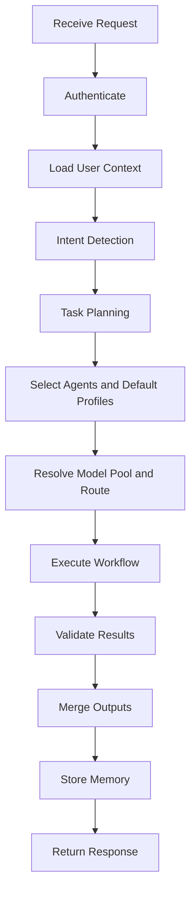
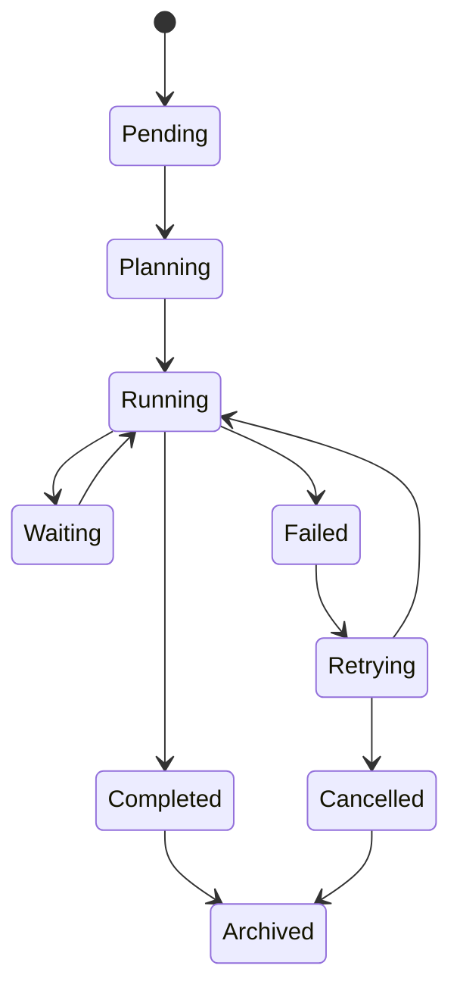
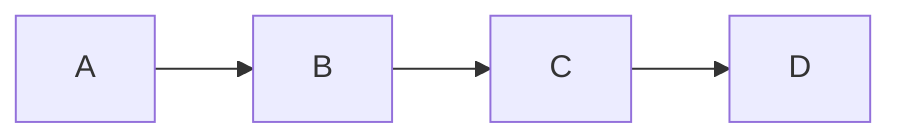
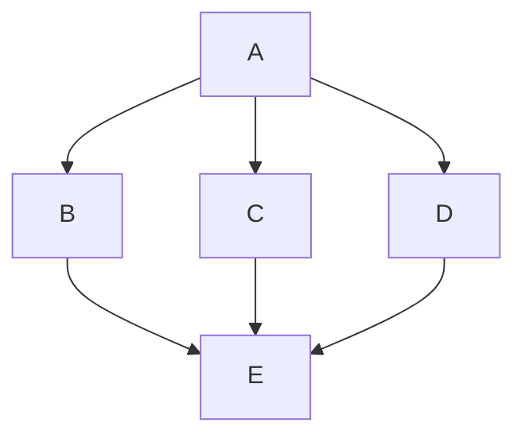
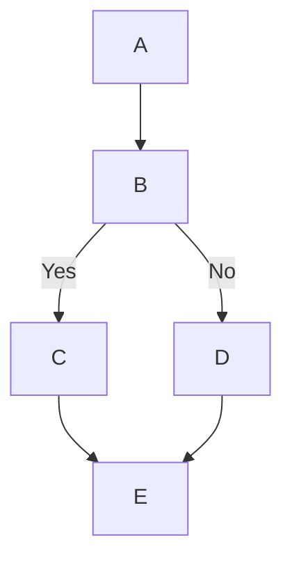
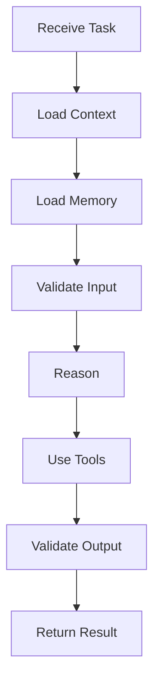

# Architecture.md

**Project:** TotalOrch

**Version:** 1.1

**Status:** Draft

---

# 1. Executive Summary

## 1.1 Purpose

The TotalOrch is a cloud-native, modular, and extensible orchestration system designed to coordinate multiple AI models, autonomous agents, external tools, APIs, and workflows through a unified execution engine.

Instead of acting as another chatbot, the platform serves as an intelligent operating system for AI. It receives complex user requests, decomposes them into executable tasks, assigns each task to the most suitable specialized agent, coordinates their execution, validates results, manages memory and context, and delivers a unified response.

The platform is intended to support applications ranging from simple conversational assistants to enterprise automation systems, research assistants, software engineering copilots, customer support automation, business process orchestration, and autonomous multi-agent systems.

---

## 1.2 Objectives

The primary architectural goals are:

- Modular architecture
- High scalability
- Cloud-native deployment
- Multi-agent collaboration
- Vendor-independent LLM integration
- Intelligent model and provider selection with safe defaults
- Explainable role-based routing
- Extensible plugin ecosystem
- Fault tolerance
- Observability
- Security by design
- Long-term maintainability
- 1.3 Target Users

The platform is designed for:

- Individual developers
- AI application developers
- SaaS providers
- Enterprises
- Research organizations
- Internal automation teams

---

## 1.3 High-Level Responsibilities

The platform shall:

- Receive requests
- Understand intent
- Plan execution
- Select agents
- Execute workflows
- Manage context
- Use tools
- Validate outputs
- Handle failures
- Persist knowledge
- Return final responses

---

# 2. Architectural Goals

The architecture is driven by several quality attributes rather than implementation technologies.


---

## 2.1 Scalability

Every component must scale independently.

No service should assume it is the only instance.

Horizontal scaling must be the default deployment strategy.

Examples:

- Multiple Orchestrators
- Multiple Agent Workers
- Multiple Tool Workers
- Multiple Memory Services


---

## 2.2 Reliability

System failures should never terminate an entire workflow.

Instead:

- Retry failed tasks
- Continue independent branches
- Recover checkpoints
- Resume interrupted workflows


---

## 2.3 Extensibility

New capabilities must be added without modifying the existing core.

Examples:

Adding

- a new AI model
- a new agent
- a new tool
- a new memory provider
- a new authentication provider

must only require implementing predefined interfaces.


---

## 2.4 Vendor Independence

No architectural dependency shall exist on a single AI provider.

Supported providers may include:

- OpenAI
- Anthropic
- Google
- xAI
- DeepSeek
- OpenRouter
- Local LLMs

The orchestration engine interacts only through an abstraction layer. The default deployment uses OmniRoute behind that abstraction as a managed internal gateway; an external gateway can be supported through the same contract.


---

## 2.5 Maintainability

The system shall follow:

- SOLID
- Clean Architecture
- Domain Driven Design
- Dependency Injection
- Interface Segregation

Every module should have a single responsibility.

---

## 2.6 Security

Security is treated as a first-class architectural concern.

Principles include:

- Least privilege
- Zero trust
- Sandboxed execution
- Secret isolation
- Auditability


---

# 3. Architecture Principles

The following principles govern every design decision.

Principle 1

Everything is a Service.

Every major capability should be independently deployable.

Examples:

- Authentication
- Workflow Engine
- Tool Service
- Memory Service
- Scheduler
- Search Service
- Principle 2

Everything communicates through contracts.

Internal services never access each other's implementation.

Only public APIs are allowed.

Principle 3

Business logic never depends on infrastructure.

Changing PostgreSQL to MySQL must not affect business logic.

Replacing Redis must not affect orchestration.

Changing OpenAI to Anthropic must not affect agents.

Principle 4

Agents are stateless.

Long-term information belongs to Memory Services.

Agents receive:

Input

↓

Context

↓

Tools

↓

Return Result

Nothing more.

Principle 5

Every operation is observable.

Every request generates:

Request ID
Trace ID
Execution Log
Performance Metrics
Cost Metrics


# 4. High-Level System Architecture

The platform consists of logical layers plus an explicit execution-gateway boundary. The gateway is shown separately because it is replaceable infrastructure and is not part of the Orchestrator Brain.

                    Users
                      │
               Web / Mobile / API
                      │
               API Gateway Layer
                      │
          Authentication & Authorization
                      │
              Orchestrator Core Layer
                      │
        Workflow & Task Management Layer
                      │
               Agent Runtime Layer
                      │
          Model Intelligence & Gateway Adapter
                      │
              OmniRoute Gateway
                      │
               Tool Execution Layer
                      │
         Memory & Knowledge Layer
                      │
               Data Infrastructure

Each layer exposes well-defined interfaces and remains independent from the implementation details of adjacent layers.


---

# 5. Architectural Layers
Layer 1 — Client Layer

Responsible for user interaction.

Supported clients include:

Web Dashboard
REST API
SDK
CLI
Mobile App
External Applications

Responsibilities:

Authentication
Request submission
Workflow visualization
Monitoring
Administration
Layer 2 — API Gateway

Acts as the single entry point.

Responsibilities include:

Authentication
Authorization
Rate limiting
Request validation
API versioning
Logging
Request routing
Compression
CORS
WebSocket support
Layer 3 — Orchestrator Core

The Orchestrator is the brain of the platform.

Responsibilities include:

Task planning
Context assembly
Agent selection
Tool selection
Cost optimization
Execution control
Error recovery
State management

It never performs domain-specific work itself.

Instead, it coordinates specialized components.

The Orchestrator owns semantic model intelligence. It does not duplicate the gateway's provider adapters or credential flows.

### Model Intelligence Plane

The Model Intelligence Plane is a first-class part of the Orchestrator Core. It contains:

- Provider and model catalog synchronization
- Model Family and Model Variant normalization
- Provider Endpoint and Connection projections
- Capability resolution and conflict handling
- Default Agent Profile Builder
- Automatic Pool and Combo Builder
- Role-aware and explainable model routing
- Runtime telemetry feedback and adaptive suitability scores

The default profiles are generated automatically for core roles such as Planner, Developer/Coder, Reviewer, and Researcher. Users can customize these profiles, but a working installation must not require them to create pools from scratch.

### Gateway Adapter

The Gateway Adapter is the only Orchestrator boundary for execution-gateway communication. In the default deployment it talks to an internal OmniRoute service through its management and OpenAI-compatible APIs.

The adapter may:

- Register or update provider connections through OmniRoute
- Trigger provider validation and model discovery
- Read provider/model catalogs and runtime health data
- Send a request to a selected `provider/model` target
- Invoke a managed gateway combo for endpoint-level fallback
- Normalize gateway response metadata into Orchestrator telemetry

Provider credentials and provider-specific protocol translation remain inside OmniRoute. The Orchestrator stores normalized metadata and references, not raw provider secrets.


---

# 6. Orchestrator Core

The Orchestrator Core is the central intelligence of the platform. It does **not** perform domain-specific tasks itself. Instead, it coordinates all system components, manages execution flow, maintains context, and ensures reliable task completion.

Every incoming request passes through the Orchestrator before reaching any agent or tool.

---

## 6.1 Responsibilities

The Orchestrator Core is responsible for:

- Request lifecycle management
- Task decomposition
- Context assembly
- Agent selection
- Workflow execution
- Tool coordination
- Memory interaction
- Error handling
- Retry management
- Cost optimization
- Observability
- State persistence

---

## 6.2 Internal Components

```text
                    Orchestrator Core
                           │
 ┌─────────────────────────┼─────────────────────────┐
 │                         │                         │
Context Manager      Task Planner           Task Router
 │                         │                         │
 │                         │                         │
Memory Manager      Workflow Engine      Agent Selector
 │                         │                         │
 └─────────────────────────┼─────────────────────────┘
                           │
                  Execution Controller
                           │
                    Result Aggregator
```

---

## 6.3 Request Lifecycle

Every request follows the same lifecycle.



---

## 6.4 Execution State Machine

Each task moves through a predefined state machine.



---

## 6.5 Task Context

Every task receives an immutable execution context.

Example:

```json
{
  "task_id": "...",
  "workflow_id": "...",
  "user_id": "...",
  "conversation_id": "...",
  "priority": "normal",
  "permissions": [],
  "memory_scope": "...",
  "available_tools": [],
  "selected_model": "...",
  "trace_id": "..."
}
```

This context is passed to every participating agent.

Agents are forbidden from modifying the original execution context.

Instead, they return structured outputs.

---

# 7. Task Planning

Most user requests are too complex for a single AI model.

The Task Planner transforms one request into multiple executable tasks.

Example:

User:

> Build an AI-powered CRM.

Execution Plan:

```
Task 1
Analyze requirements

↓

Task 2
Design architecture

↓

Task 3
Generate database schema

↓

Task 4
Generate backend

↓

Task 5
Generate frontend

↓

Task 6
Generate deployment files
```

---

## Planning Pipeline

```mermaid
flowchart LR

Request

--> Intent

--> Goals

--> Constraints

--> Dependencies

--> Execution Plan

--> Workflow
```

---

## Planning Strategies

The planner supports multiple strategies.

### Sequential

Task B depends on Task A.

```
A

↓

B

↓

C
```

---

### Parallel

Independent tasks execute simultaneously.

```
A

↙   ↓   ↘

B   C   D

↘   ↓   ↙

E
```

---

### Hierarchical

Large tasks are recursively decomposed.

```
Project

├── Backend

│     ├── Auth

│     ├── API

│     └── Database

├── Frontend

└── Deployment
```

---

### Dynamic Planning

Plans may change during execution.

Example:

```
Research

↓

Need More Information?

↓

Yes

↓

Search Again

↓

Continue
```

The workflow engine supports inserting new tasks at runtime.

---

# 8. Task Router

The Task Router determines which agent should execute each task.

It uses a rule-based scoring system combined with capability matching.

---

## Routing Inputs

The router considers:

- Intent
- Task Type
- Required Skills
- Required Tools
- User Preferences
- Cost Budget
- Model Availability
- Current Load
- Latency
- Agent Health
- Model Family and Variant
- Required model capabilities
- Default Agent Profile
- Provider Endpoint health and availability
- Historical task-specific success rate
- Reasoning effort and structured-output requirements

---

## Routing Example

```
Task

↓

Research Required

↓

Research Agent

↓

Need Web Search

↓

Search Tool

↓

Return Findings
```

---

## Routing Policies

### Capability Based

Choose the agent with the required capability.

---

### Cost Based

Choose the cheapest suitable model.

---

### Latency Based

Choose the fastest available worker.

---

### Hybrid

Weighted score using:

```
Score =
Role Fit × w1
+ Capability Fit × w2
+ Quality / Task Fit × w3
+ Health × w4
+ Latency × w5
+ Cost × w6
+ Availability / Quota × w7
+ Historical Success × w8
```

Hard capability constraints are applied before scoring. The weights are policy-driven, have safe defaults, and may be customized by users or projects.

Every decision should produce an explanation containing the selected endpoint, score breakdown, excluded candidates and reasons, exploration state, and fallback path.

## Default Agent Profiles and Pools

The platform creates default profiles after provider and model synchronization:

| Agent | Default capability requirements | Typical pool policy |
| :--- | :--- | :--- |
| Planner | reasoning, structured output, sufficient context | quality-first and reliable |
| Developer/Coder | tool calling, coding fit, long context | balanced quality and latency |
| Reviewer | code analysis, reasoning, structured output | quality-first and stable |
| Researcher | tool calling, search or browsing support, long context | reliable and availability-aware |

Pools are generated from rules rather than manually maintained lists. Examples include `tool_calling`, `openai/luna-family`, `large_context_reasoning`, and `planner-quality`.

## OmniRoute Integration Boundary

OmniRoute is the default execution gateway, not the Orchestrator Brain. The Orchestrator selects the role, pool, policy, and allowed target set. OmniRoute resolves credentials, translates protocols, performs endpoint-level health checks, executes the request, and applies operational retry/fallback.

The public product API and UI hide OmniRoute's management surface. An advanced deployment may connect to an existing external OmniRoute instance through the same adapter.

---

# 9. Workflow Engine

The Workflow Engine executes the plan generated by the planner.

It manages dependencies, retries, branching, loops, checkpoints, and human approval.

---

## Supported Workflow Types

- Sequential
- Parallel
- Conditional
- Loop
- Event Driven
- Scheduled
- Human-in-the-loop

---

## Sequential Workflow



---

## Parallel Workflow



---

## Conditional Workflow



---

## Retry Workflow

```mermaid
flowchart TD

Execute

↓

Success?

↓

No

↓

Retry

↓

Exceeded?

↓

Yes

↓

Failed

↓

No

↓

Execute
```

---

## Human Approval Workflow

Certain workflows require manual approval.

Example:

```
Generate Contract

↓

Human Review

↓

Approved?

↓

Deploy
```

This enables enterprise-grade governance.

---

# 10. Agent Runtime

The Agent Runtime is responsible for executing domain-specific tasks. Unlike the Orchestrator, which coordinates execution, agents perform the actual reasoning and produce outputs.

Each agent is isolated, stateless, independently deployable, and communicates only through the Orchestrator.

---

## Design Principles

Every agent must be:

- Stateless
- Replaceable
- Independently scalable
- Observable
- Versioned
- Sandboxed
- Self-describing

Agents never communicate directly with each other.

All communication passes through the Orchestrator.

---

## Agent Lifecycle



---

## Standard Agent Interface

Every agent implements the following interface.

```typescript
interface Agent {

    metadata()

    capabilities()

    validate()

    execute()

    health()

}
```

---

## Agent Metadata

Each agent exposes metadata for automatic discovery.

Example:

```json
{
    "id": "research-agent",
    "version": "1.2.0",
    "description": "Internet research specialist",
    "capabilities": [
        "research",
        "fact-checking",
        "summarization"
    ],
    "supportedTools": [
        "web-search",
        "browser"
    ],
    "maxConcurrency": 25
}
```

---

## Agent Categories

### Planner Agent

Responsibilities

- Break down tasks
- Generate execution plans
- Estimate complexity
- Estimate cost
- Detect dependencies

---

### Research Agent

Responsibilities

- Internet research
- Knowledge retrieval
- Fact checking
- Source validation
- Summarization

---

### Coding Agent

Responsibilities

- Generate code
- Refactor
- Explain code
- Create documentation
- Generate tests

---

### Reviewer Agent

Responsibilities

- Quality control
- Detect hallucinations
- Verify outputs
- Validate formatting
- Check completeness

---

### Memory Agent

Responsibilities

- Retrieve memories
- Store memories
- Rank memories
- Remove obsolete memories

---

### Tool Agent

Responsibilities

- Execute tools
- Handle failures
- Retry
- Normalize outputs

---

### Custom Agents

Developers may register custom agents using the Agent SDK.

Examples:

- Finance Agent
- Medical Agent
- Legal Agent
- Marketing Agent
- Translation Agent
- Customer Support Agent

---

# 11. Agent Communication

Agents never communicate directly.

Instead:

```text
Agent A

↓

Orchestrator

↓

Agent B
```

Advantages

- Better security
- Easier monitoring
- Simpler retries
- Reduced coupling
- Centralized logging

---

## Message Format

Every inter-agent message follows the same structure.

```json
{
    "taskId": "...",
    "sender": "...",
    "receiver": "...",
    "payload": {},
    "traceId": "...",
    "timestamp": "...",
    "priority": "normal"
}
```

---

# 12. Tool Manager

The Tool Manager provides a unified interface for every executable capability outside the LLM itself.

Examples include:

- Browser
- Search
- Python
- SQL
- APIs
- Filesystem
- Email
- GitHub
- Docker
- Kubernetes
- Shell

---

## Architecture

```mermaid
flowchart TD

Agent

-->

Tool Manager

-->

Tool Adapter

-->

External Tool

-->

Result

-->

Agent
```

---

## Responsibilities

The Tool Manager performs:

- Tool discovery
- Permission validation
- Parameter validation
- Timeout handling
- Retry logic
- Error normalization
- Logging
- Metrics
- Rate limiting

---

## Tool Interface

```typescript
interface Tool {

    metadata()

    validate()

    execute()

    health()

}
```

---

## Tool Metadata

```json
{
    "id": "python",
    "version": "2.1",
    "description": "Python execution environment",
    "permissions": [
        "filesystem"
    ],
    "timeout": 60,
    "sandboxed": true
}
```

---

# 13. Plugin Framework

The platform supports external plugins.

A plugin may provide:

- Agents
- Tools
- Memory Providers
- Authentication Providers
- Workflow Nodes
- UI Extensions

---

## Plugin Lifecycle


---

## Plugin Manifest

```json
{
    "name": "github-plugin",
    "version": "1.0.0",
    "author": "Example",
    "tools": [
        "github"
    ],
    "agents": [],
    "permissions": [
        "network"
    ]
}
```

---

# 14. MCP Integration

The platform supports the Model Context Protocol (MCP).

MCP enables standardized communication with external tools and data providers.

Examples

- IDEs
- Databases
- Cloud Providers
- Documentation Servers
- Git Repositories
- Local Applications

---

## MCP Architecture

```mermaid
flowchart TD

Agent

-->

MCP Client

-->

MCP Server

-->

External Resource
```

---

## Benefits

- Vendor-independent
- Standardized interfaces
- Dynamic capability discovery
- Easier maintenance
- Secure tool execution

---

# 15. Memory System

The memory architecture is divided into four layers.

```text
Short-term Memory

↓

Working Memory

↓

Long-term Memory

↓

Knowledge Base
```

---

## Short-term Memory

Stores:

- Current conversation
- Current workflow
- Temporary variables

Lifetime

Minutes to hours.

---

## Working Memory

Stores:

- Execution state
- Intermediate outputs
- Active workflow variables
- Task dependencies

Lifetime

Until workflow completion.

---

## Long-term Memory

Stores information across sessions.

Examples

- User preferences
- Frequently used prompts
- Personal settings
- Project history
- Learned behaviors

---

## Knowledge Base

Contains organizational knowledge.

Examples

- Documentation
- Product manuals
- Company policies
- Technical specifications
- Research papers

---

# 16. Vector Memory

Semantic retrieval is implemented using embeddings.

Architecture

```mermaid
flowchart TD

Document

-->

Chunking

-->

Embedding

-->

Vector Database

-->

Similarity Search

-->

Relevant Context

-->

LLM
```

---

## Retrieval Pipeline

1. Split documents

2. Generate embeddings

3. Store vectors

4. Semantic search

5. Re-rank

6. Inject into prompt

---

## Supported Sources

- PDFs
- Markdown
- Word
- HTML
- Databases
- Git Repositories
- APIs
- Websites

---

# 17. Context Manager

The Context Manager constructs the final context window supplied to an agent.

It gathers information from multiple sources.

```text
User Input

+

Conversation

+

Workflow State

+

Retrieved Memory

+

Knowledge Base

+

Tool Results

↓

Final Context
```

---

## Context Prioritization

Priority order

1. System Instructions

2. Security Policies

3. Workflow Context

4. User Request

5. Retrieved Memories

6. External Documents

7. Previous Outputs

Lower-priority context may be truncated when token limits are reached.

---

## Context Optimization

Strategies include:

- Deduplication
- Summarization
- Compression
- Semantic filtering
- Token budgeting
- Relevance scoring

This ensures that only the most valuable information is passed to the language model while minimizing token usage and execution cost.

---
