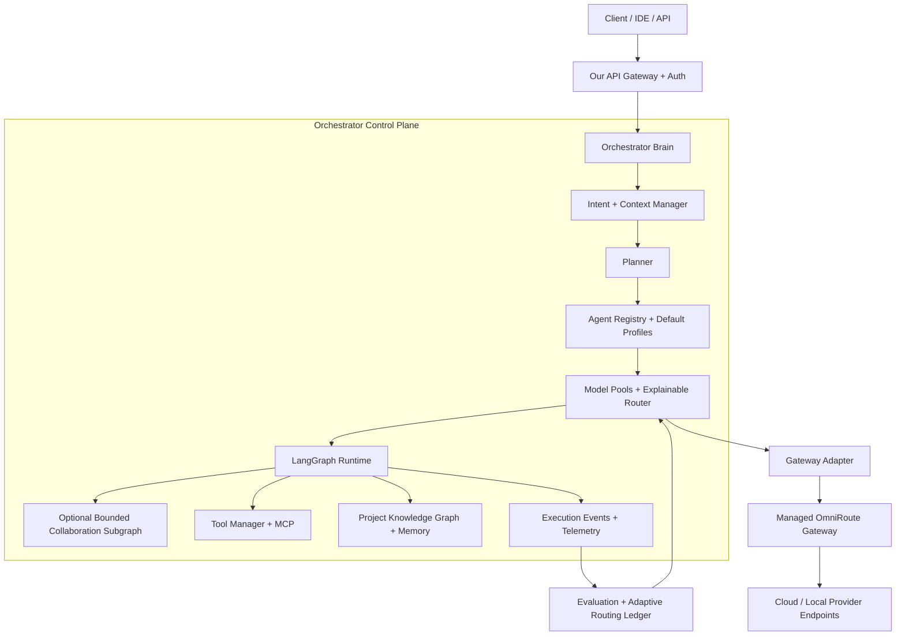

# AI_Agents_Orchestrator_Analysis.md

## Purpose

This document records the architectural ideas from [hoangsonww/AI-Agents-Orchestrator](https://github.com/hoangsonww/AI-Agents-Orchestrator) that are relevant to the TotalOrch.

The repository is used as an architectural reference, not as a dependency or a codebase to copy wholesale. The goal is to identify reusable patterns, map them to our architecture, and explicitly document what must remain different because of our OmniRoute, Model Intelligence, LangGraph, and production requirements.

Reference documents reviewed:

- [Repository overview and README](https://github.com/hoangsonww/AI-Agents-Orchestrator)
- [Architecture](https://github.com/hoangsonww/AI-Agents-Orchestrator/blob/main/ARCHITECTURE.md)
- [Orchestrator](https://github.com/hoangsonww/AI-Agents-Orchestrator/blob/main/ORCHESTRATOR.md)
- [Agentic Team](https://github.com/hoangsonww/AI-Agents-Orchestrator/blob/main/AGENTIC_TEAM.md)
- [Graphify](https://github.com/hoangsonww/AI-Agents-Orchestrator/blob/main/GRAPHIFY.md)
- [Agentic Infrastructure](https://github.com/hoangsonww/AI-Agents-Orchestrator/blob/main/AGENTIC_INFRA.md)

## Executive Summary

The most valuable ideas to adopt are:

1. Separating the deterministic workflow orchestrator from the free-communication Agentic Team runtime.
2. Using explicit adapter contracts for external AI executors.
3. Treating workflows, agents, skills, tools, and context as independently extensible units.
4. Using a bounded, structured turn protocol for multi-agent collaboration.
5. Maintaining a project-scoped, queryable context graph with typed nodes and edges.
6. Combining reusable skills, specialized agent definitions, domain rules, and MCP tools as shared agentic infrastructure.
7. Emitting structured runtime events that support live timelines, communication graphs, logs, and post-run analysis.

These ideas fit our platform when they are placed below our Orchestrator Brain and above the managed OmniRoute Gateway. They do not replace our Model Registry, Default Agent Profiles, Explainable Router, LangGraph Runtime, or Gateway Adapter.

## 1. What the Reference Repository Contains

The reference repository presents several related but independently bounded systems:

```text
AI Coding Tools Repository
├── Orchestrator
│   ├── CLI / Web UI
│   ├── Workflow Engine
│   ├── Task Manager
│   └── External-agent adapters
├── Agentic Team Runtime
│   ├── Role-based agents
│   ├── Free communication turns
│   ├── Lead-gated finalization
│   └── Live communication graph
├── Graphify
│   ├── Project scanner
│   ├── Code knowledge graph
│   ├── Hybrid search
│   └── REST / visualization surfaces
├── MCP Server
└── Shared Agentic Infrastructure
    ├── Specialized agents
    ├── Skills
    ├── Domain rules
    └── MCP tools
```

The repository intentionally keeps the Orchestrator and Agentic Team as separate runtime paths. They share infrastructure concepts, but they are not the same execution engine. This separation is useful for our design because deterministic workflows and open-ended collaboration have different reliability, latency, and observability requirements.

## 2. Architectural Patterns Worth Adopting

### 2.1 Separate deterministic workflows from open collaboration

The reference project distinguishes:

- A step-based Orchestrator for predictable workflows such as implement → review → refine.
- An Agentic Team runtime where role-based agents exchange messages freely until a lead role finalizes the result.

Our decision:

- Use LangGraph as the primary deterministic execution runtime.
- Add collaboration nodes or a bounded collaboration subgraph for open-ended teamwork.
- Do not create a second independent runtime with duplicated state, configuration, and telemetry unless a later scale requirement proves it necessary.

```text
Task
  ├── Deterministic workflow → LangGraph state graph
  └── Collaboration phase → bounded Agentic Collaboration subgraph
                              ├── role roster
                              ├── turn budget
                              ├── structured action protocol
                              └── lead-gated finalization
```

### 2.2 Explicit adapter boundary

The reference repository uses a common adapter contract for different external executors such as Claude, Codex, Gemini, Copilot, Ollama, and llama.cpp. The adapter exposes capability discovery, task execution, availability checks, timeouts, parsing, and error handling.

Our version keeps the principle but changes the boundary:

```text
Agent / LangGraph Node
        ↓
Orchestrator Model Execution Contract
        ↓
Gateway Adapter
        ↓
OmniRoute
        ↓
Provider Endpoint
```

We should not recreate one adapter per Provider in the Orchestrator. OmniRoute owns provider adapters, credentials, protocol translation, streaming, and operational fallback. Our adapter represents the stable contract between the Orchestrator and the gateway.

### 2.3 Configuration-driven workflows with validation

The reference workflow engine supports named workflows, ordered steps, agent bindings, iterative refinement, step-level fallback, and offline filtering. It validates the workflow before execution and keeps failures bounded.

Our workflow model should support the same concepts, but workflow generation remains dynamic:

- Built-in templates provide safe defaults.
- The Planner may generate a task-specific graph.
- Users may provide reusable workflows.
- Every generated workflow is validated against available Agent Definitions, tools, model capabilities, policies, and security constraints.
- Every step has timeout, retry, fallback, checkpoint, and approval metadata.

### 2.4 Structured collaboration decisions

The Agentic Team runtime routes turns through a structured decision response. A role can send a message to another role or finalize through the lead role. The engine normalizes decisions, enforces turn limits, and emits communication events.

Our collaboration protocol should use a schema similar to:

```json
{
  "action": "message",
  "from_role": "architect",
  "to_role": "developer",
  "content": "Implement the API contract and add validation tests.",
  "evidence": ["task-plan-42"],
  "requires_approval": false
}
```

Finalization must be explicit and restricted to an authorized lead or Orchestrator decision node:

```json
{
  "action": "finalize",
  "from_role": "reviewer",
  "summary": "Implementation passes validation and review.",
  "artifacts": ["patch-42", "test-report-42"]
}
```

Malformed, unauthorized, cyclic, or over-budget decisions must be rejected or converted to a bounded fallback response.

### 2.5 Typed project context graph

Graphify models project knowledge as typed nodes and edges and supports project-scoped graph partitions. Its context system combines keyword search, semantic search, and reciprocal-rank fusion. It also supports deterministic project identifiers, incremental scanning, graph export, and visualization.

These are strong patterns for our Project Knowledge and Context Manager layers:

- Project-scoped isolation
- Deterministic project identity
- Typed knowledge nodes
- Typed relationships
- Hybrid retrieval
- Incremental indexing
- Explainable context provenance
- Exportable graph representations

Suggested node categories for our platform:

```text
Project, File, Symbol, Dependency, Task, Decision, Mistake,
Pattern, CodeSnippet, Conversation, Preference, AgentResult,
WorkflowRun, TestResult, ProviderObservation
```

Suggested relationships:

```text
DEPENDS_ON, IMPORTS, CONTAINS, RELATED_TO, CAUSED_BY,
FIXED_BY, SIMILAR_TO, PRECEDED_BY, USED_IN, DERIVED_FROM,
VALIDATED_BY, PRODUCED_BY, ROUTED_TO
```

The graph is a knowledge and context subsystem. It does not replace LangGraph checkpoints, the execution ledger, the Model Registry, or the adaptive routing ledger.

### 2.6 Shared agentic infrastructure

The reference project treats specialized agents, reusable skills, domain rules, and MCP tools as shared infrastructure used by multiple runtime paths.

Our equivalent should provide:

- Agent Definitions with role, capabilities, input/output contracts, policies, and health checks.
- Skills as reusable, versioned task knowledge and procedural guidance.
- Domain Rules for security, API design, testing, databases, performance, and project conventions.
- Tools registered through the Tool Manager and exposed through controlled MCP integration.
- Context retrieval available to both deterministic workflow nodes and collaboration roles.

This supports our requirement that default agents work immediately while advanced users can add custom agents, skills, tools, and policies.

### 2.7 Event-based observability

The reference Agentic Team emits events for turns, directed communication, progress, timelines, graphs, and logs. We should adopt the event model, while adding platform-wide tracing:

```text
WorkflowEvent
  ├── task_id
  ├── workflow_run_id
  ├── node_id
  ├── agent_id / role
  ├── model_family / model_variant
  ├── provider_endpoint
  ├── action
  ├── input/output references
  ├── latency / cost / tokens
  ├── validation result
  └── trace_id
```

The same event stream should feed the UI timeline, workflow graph, audit log, execution ledger, Model/Provider performance matrix, and explainable routing history.

## 3. Mapping to Our Architecture

| Reference concept | Our implementation | Decision |
| :--- | :--- | :--- |
| Step-based Orchestrator | LangGraph-backed Workflow Runtime | Adopt the pattern; use LangGraph for state and checkpoints |
| Agentic Team | Bounded collaboration subgraph | Adopt selectively; do not create an unbounded second runtime |
| Base Adapter | Gateway Adapter + Agent Execution Contract | Adopt the interface principle; OmniRoute owns Provider adapters |
| Agent role definitions | Agent Registry and Default Agent Profiles | Adopt and extend with model-pool requirements |
| Skills library | Versioned Skills Registry | Adopt; attach skills to Agent Definitions and workflows |
| Domain rules | Policy and Rule Registry | Adopt; enforce before execution and routing |
| MCP server/tools | Tool Manager + MCP Integration | Adopt with scoped permissions, audit, timeout, and sandboxing |
| Graphify | Project Knowledge Graph | Adopt the graph/context pattern; integrate with our Memory and Context Manager |
| Context Dashboard | Orchestrator observability UI | Adopt the visualization idea, but use our unified event and trace model |
| CLI communicator | Gateway/Tool execution boundary | Do not use as the primary model path; retain only for explicitly supported local tools |
| SQLite graph storage | Local/offline graph backend | Adopt for local mode; use PostgreSQL-compatible storage for scalable deployments |

## 4. Target Architecture After Incorporation



The important boundary is:

- The Orchestrator selects the Agent, role, Pool, policy, and permitted target set.
- LangGraph executes the workflow and checkpoints state.
- The optional collaboration subgraph coordinates bounded role-to-role communication.
- The Gateway Adapter sends execution requests to OmniRoute.
- OmniRoute resolves credentials, executes the Provider request, and handles operational retry/fallback.
- The Knowledge Graph provides project context; it does not become the workflow state store.

## 5. What We Should Not Copy

### 5.1 Do not copy the repository as a runtime dependency

The reference project is a useful design reference, but importing its Orchestrator or Agentic Team runtime would introduce a second state model, second configuration system, second adapter surface, and duplicate observability paths.

### 5.2 Do not duplicate Provider adapters

The reference project has adapters for external coding CLIs and local runtimes. Our default model path is Provider-agnostic through OmniRoute. We should only implement local-process adapters where a capability cannot be represented through the gateway.

### 5.3 Do not make collaboration unbounded

Free communication is useful for exploration, but it can create token cost, latency, cycles, and unclear responsibility. Our collaboration runtime must enforce:

- Maximum turns
- Token and cost budgets
- Role permissions
- Allowed recipients
- Tool permissions
- Explicit lead-gated finalization
- Cancellation and timeout
- Checkpoints and resumability

### 5.4 Do not make manual configuration the default

The reference project exposes configuration-driven agents and workflows. Our product should preserve that extensibility while generating default Agent Profiles and Model Pools automatically from the Model Intelligence Layer.

### 5.5 Do not treat graph memory as all memory

The Project Knowledge Graph is excellent for code and project relationships. It does not replace:

- Short-term LangGraph checkpoints
- Working context
- Long-term user/project memory
- Execution traces
- Provider health and model performance telemetry

## 6. Proposed Internal Contracts

### Agent Definition

```json
{
  "id": "developer",
  "role": "Developer/Coder",
  "capabilities": ["coding", "tool_calling", "repository_editing"],
  "required_model_capabilities": ["tool_calling", "structured_output"],
  "default_pool": "coder-default",
  "skills": ["implementation", "testing", "error-handling"],
  "tools": ["filesystem", "shell", "test_runner"],
  "supports_hitl": true,
  "version": "1.0"
}
```

### Workflow Definition

```json
{
  "id": "feature-development",
  "steps": [
    {"id": "plan", "agent": "planner", "depends_on": []},
    {"id": "implement", "agent": "developer", "depends_on": ["plan"]},
    {"id": "review", "agent": "reviewer", "depends_on": ["implement"]},
    {"id": "test", "agent": "tester", "depends_on": ["review"]}
  ],
  "limits": {
    "max_duration_seconds": 1800,
    "max_retries_per_step": 2
  }
}
```

### Collaboration Decision

```json
{
  "action": "message | request_tool | request_review | finalize",
  "from_role": "architect",
  "to_role": "developer",
  "content": "...",
  "artifacts": [],
  "evidence": [],
  "requires_approval": false
}
```

### Context Graph Node

```json
{
  "id": "node-123",
  "project_id": "project-abc",
  "type": "Decision",
  "content": "Use OmniRoute as the managed internal gateway.",
  "source": "architecture-decision",
  "confidence": 1.0,
  "created_at": "...",
  "updated_at": "..."
}
```

## 7. Implementation Roadmap

### Phase 1 — Core contracts

- Define Agent Definition, Skill, Tool, Workflow, and Collaboration Decision schemas.
- Define Gateway Adapter and Model Execution contracts.
- Add structured workflow events and trace IDs.
- Implement default Planner, Developer/Coder, Reviewer, and Researcher profiles.

### Phase 2 — Deterministic execution

- Implement LangGraph workflow nodes and checkpointing.
- Add validation, retry, fallback, cancellation, and Human-in-the-Loop boundaries.
- Connect the Model Registry and Default Pool Builder to the Router.
- Route model execution through OmniRoute.

### Phase 3 — Project context intelligence

- Add project scanning and incremental indexing.
- Implement typed Project Knowledge Graph nodes and edges.
- Add BM25 + semantic hybrid retrieval.
- Attach context provenance to Planner and Agent inputs.

### Phase 4 — Collaboration mode

- Add bounded collaboration as a LangGraph subgraph.
- Implement role roster validation and lead-gated finalization.
- Add live turn timeline, communication graph, and structured collaboration logs.
- Feed collaboration outcomes into the execution and routing ledgers.

### Phase 5 — Shared agentic infrastructure

- Add versioned Skills Registry and Domain Rules.
- Add scoped MCP tools with audit, timeout, rate limits, and sandboxing.
- Add custom Agent/Skill/Tool plugin contracts.
- Add graph export and project-context inspection.

## 8. Final Decision

The reference repository contributes architectural patterns, not a second foundation for our platform.

We will adopt:

- Separate workflow and collaboration concepts
- Explicit adapter contracts
- Validated, iterative, checkpointed workflows
- Structured collaboration decisions
- Project-scoped typed knowledge graphs
- Shared Agents, Skills, Rules, Tools, and MCP infrastructure
- Event-driven observability and explainable execution history

We will keep our own:

- Orchestrator Brain
- Model Registry and Capability Graph
- Default Agent Profile and Pool Builder
- Explainable Router
- LangGraph execution integration
- OmniRoute Gateway Adapter
- Adaptive routing and task-outcome learning ledger

The result is a selective architectural adoption: the reference project's strongest ideas improve our Agent and Context layers without weakening the ownership boundaries established in [Vision](../Vision.md), [Architecture](../Architecture.md), [Gateway Comparison](./Gateway_Comparison.md), and [Model Catalog Research](./Model_Catalog_Research.md).
